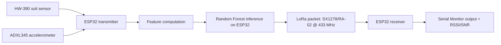
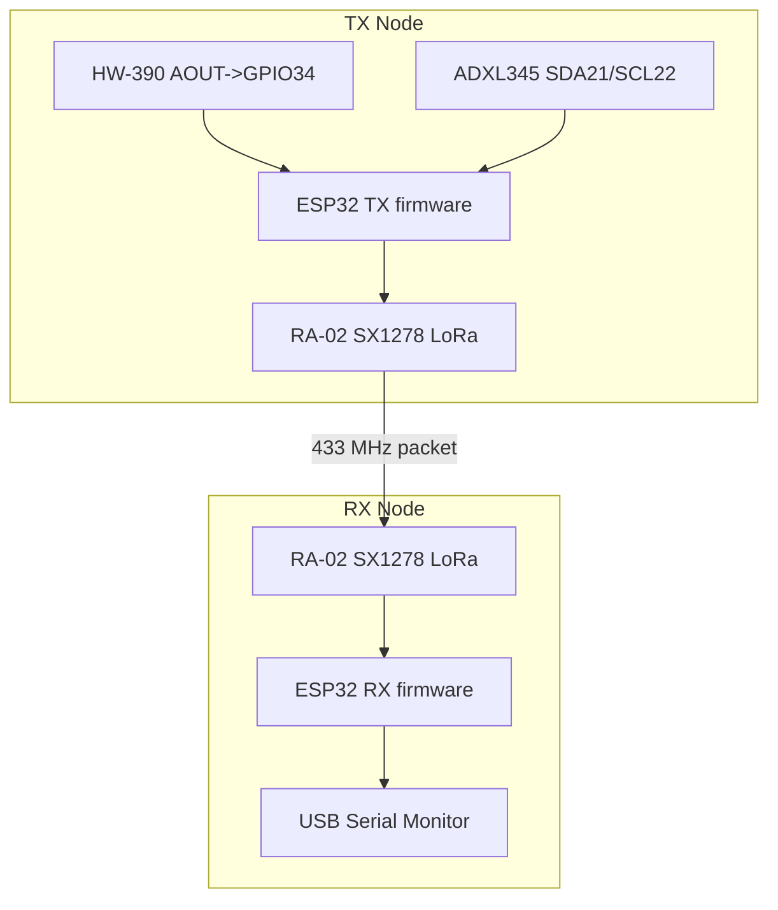
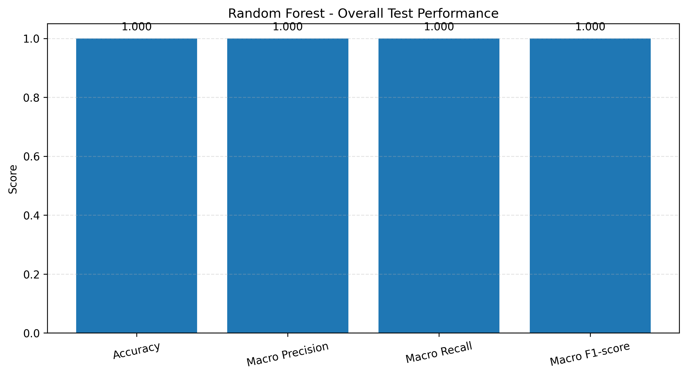
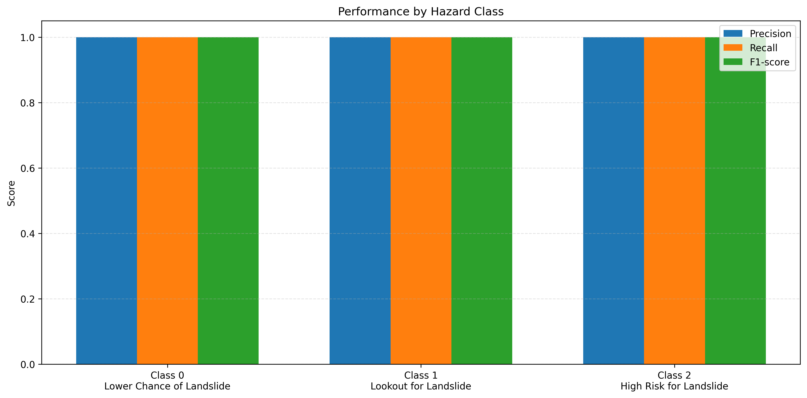
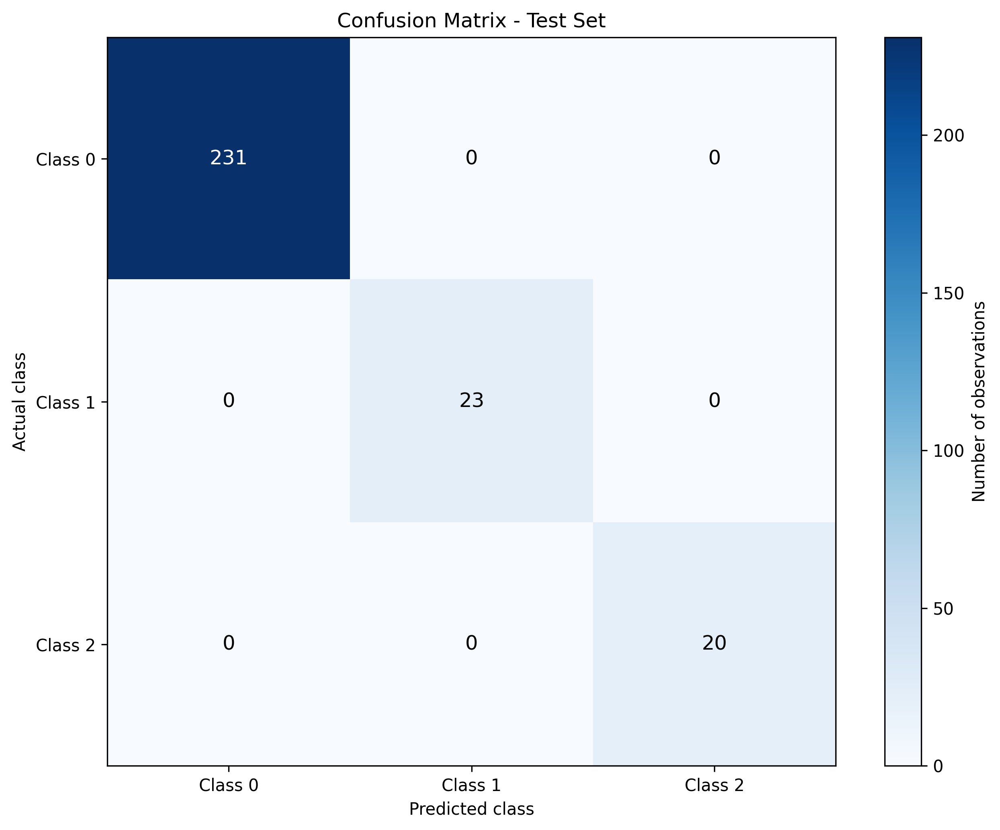
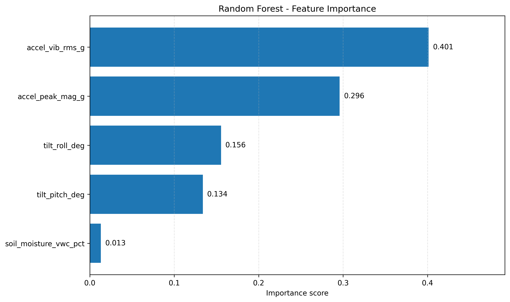

# ESP32-Based Landslide Hazard Classification Using a Random Forest Model and LoRa Communication

## Table of Contents
- [1. Overview and Scope](#1-overview-and-scope)
- [2. Dataset and Provenance](#2-dataset-and-provenance)
- [3. Hazard Classes](#3-hazard-classes)
- [4. Hardware and Wiring](#4-hardware-and-wiring)
- [5. Embedded Inference Pipeline](#5-embedded-inference-pipeline)
- [6. Machine Learning Methodology](#6-machine-learning-methodology)
- [7. Experimental Results](#7-experimental-results)
- [8. Experiments and Validation](#8-experiments-and-validation)
- [9. LoRa Packet Format](#9-lora-packet-format)
- [10. Software Requirements and Setup](#10-software-requirements-and-setup)
- [11. Repository Structure](#11-repository-structure)
- [12. Limitations and Responsible Use](#12-limitations-and-responsible-use)
- [13. Intellectual Property and Collaboration](#13-intellectual-property-and-collaboration)
- [14. Future Roadmap](#14-future-roadmap)

---

## 1. Overview and Scope

This repository implements an **experimental edge-ML landslide-hazard classification prototype**:

1. Sensors are read on an ESP32 transmitter node.
2. A Random Forest model runs locally on the ESP32.
3. A packet with features, class prediction, and class probabilities is sent over **433 MHz LoRa (SX1278/RA-02)**.
4. A second ESP32 receiver prints parsed values and radio metrics to Serial Monitor.

The project uses three target hazard categories (Section 3) and is built around the following sensing concepts reflected in code and dataset fields:

- **HW-390 soil sensor** (analog ADC-based percentage in firmware).
- **ADXL345 accelerometer** for vibration and tilt-derived features.
- **ESP32** for acquisition + inference.
- **LoRa** for low-bandwidth telemetry.

Local inference can reduce reliance on continuous cloud connectivity for classification execution, but this repository does **not** provide a guarantee of cloud independence, reliability, or operational warning readiness.

> This is a classification prototype, not a validated operational public early-warning system.

### Architecture (implemented components)



---

## 2. Dataset and Provenance

Primary dataset: `/home/runner/work/Landslide_RF_Project/Landslide_RF_Project/data/idukki_landslide_dataset.csv`

### 2.1 Owner-reported provenance vs repository evidence

- **Owner-reported context** (from project statements): observations from Idukki, Kerala, associated with 2018–2021 landslide periods, including before/during/after-event conditions.
- **Repository-evidenced fields**: timestamps, event-source names, engineered sensor features, and hazard labels.
- Exact monitoring installation details, labeling protocol, instrumentation campaign metadata, and independent source validation are **not documented in this repository**.

### 2.2 Schema (verified from CSV)

| Column | Role in project | Evidence in code/artifacts |
|---|---|---|
| `timestamp` | Observation time index | Parsed and sorted in `src/train_model.py` |
| `rainfall_24h` | Rainfall feature in dataset; excluded from current ESP32 model inputs | Explicitly excluded in `src/train_model.py` |
| `soil_moisture_vwc_pct` | Soil moisture model feature | Included in model input feature list |
| `accel_vib_rms_g` | Vibration RMS feature | Included in model input feature list |
| `accel_peak_mag_g` | Peak vibration magnitude feature | Included in model input feature list |
| `tilt_pitch_deg` | Tilt pitch feature | Included in model input feature list |
| `tilt_roll_deg` | Tilt roll feature | Included in model input feature list |
| `hazard_label` | Supervised target class | Training target in `src/train_model.py` |
| `event_source` | Event annotation/source grouping string | Used in dataset analysis (`src/analyze_dataset.py`) |

### 2.3 Dataset summary (verified)

- Row count: **1368**
- Column count: **9**
- Date range: **2018-08-01 00:00:00** to **2021-10-24 23:00:00**
- Missing values: **none** across all columns
- Exact duplicate rows: **0**

#### Class distribution (`hazard_label`)

| Class | Count | Percent |
|---:|---:|---:|
| 0 | 1035 | 75.66% |
| 1 | 237 | 17.32% |
| 2 | 96 | 7.02% |

#### Event-source distribution

| event_source | Count |
|---|---:|
| `2018_August_Kerala_Disaster_Idukki` | 528 |
| `2020_August_Pettimudi_Landslide_Idukki` | 480 |
| `2021_October_Kokkayar_Landslide_Idukki` | 360 |

### 2.4 Measured vs derived vs annotated vs model-generated

- **Measured/collected observations** (as stored): timestamped rainfall and sensor-derived numeric fields.
- **Derived features**: `accel_vib_rms_g`, `accel_peak_mag_g`, `tilt_pitch_deg`, `tilt_roll_deg` are feature-engineered quantities by definition/name and by firmware pipeline design.
- **Event annotations**: `event_source` appears to be a categorical annotation.
- **Supervised target labels**: `hazard_label` is used as training target; label-generation methodology is undocumented in repository files.
- **Model-generated outputs** are not in the main dataset; they appear in artifacts such as `results/cpp_test_vectors.csv` (`predicted_class`, `p0/p1/p2`).

### 2.5 Pre-event / event / post-event coverage

The repository does **not** include an explicit phase column (e.g., pre-event/during-event/post-event). Availability of those phases is therefore **owner-reported** and not independently verifiable from a dedicated field.

---

## 3. Hazard Classes

The implemented class mapping is:

| Class | Label |
|---:|---|
| 0 | Lower Chance of Landslide |
| 1 | Lookout for Landslide |
| 2 | High Risk for Landslide |

These are target categories for supervised classification. They are **not calibrated probabilities**, guaranteed forecasts, or operational warning levels.

---

## 4. Hardware and Wiring

Verified from firmware constants and initialization calls.

### 4.1 Hardware components evidenced in repository

- ESP32 board (transmitter firmware)
- ESP32 board (receiver firmware)
- HW-390 soil moisture sensor (analog pin read)
- ADXL345 accelerometer (I2C access, address `0x53`)
- RA-02/SX1278 LoRa module at 433 MHz
- 433 MHz antenna and stable 3.3V power (required for practical operation; power safety also noted in prior docs)

### 4.2 Verified pin mapping

| Subsystem | Signal | ESP32 pin | Evidence |
|---|---|---:|---|
| Soil sensor | AOUT | GPIO34 | `SOIL_PIN = 34` |
| ADXL345 (I2C) | SDA | GPIO21 | `I2C_SDA = 21`, `Wire.begin(I2C_SDA, I2C_SCL)` |
| ADXL345 (I2C) | SCL | GPIO22 | `I2C_SCL = 22` |
| LoRa SPI | SCK | GPIO18 | `SPI.begin(18, 19, 23, LORA_SS)` |
| LoRa SPI | MISO | GPIO19 | same call |
| LoRa SPI | MOSI | GPIO23 | same call |
| LoRa SPI | NSS/CS | GPIO5 | `LORA_SS = 5` |
| LoRa control | RESET | GPIO14 | `LORA_RST = 14` |
| LoRa IRQ | DIO0 | GPIO26 | `LORA_DIO0 = 26` |

### 4.3 Hardware topology



---

## 5. Embedded Inference Pipeline

### 5.1 Runtime sequence (implemented)

From transmitter firmware logic:

1. ADXL345 sampled at ~100 Hz (`SAMPLE_RATE_HZ = 100.0`, scheduler via `micros()`).
2. Soil sensor read roughly once per second (`nextSoilMillis += 1000`).
3. Soil percentages are accumulated (`soilSum`, `soilReadCount`).
4. A processing window runs after ~10 one-second soil updates (`soilReadCount >= WINDOW_SECONDS`, with `WINDOW_SECONDS = 10.0`).
5. Window features are computed and inference is executed.
6. Probabilities are averaged across all trees.
7. Argmax selects class.
8. LoRa packet is transmitted when radio is available.

### 5.2 Exact feature order used for inference

The feature array in firmware and export comments is:

1. `soil_moisture_vwc_pct`
2. `accel_vib_rms_g`
3. `accel_peak_mag_g`
4. `tilt_pitch_deg`
5. `tilt_roll_deg`

### 5.3 Feature calculations in firmware

- **Soil percentage**: computed from raw ADC using constants `SOIL_DRY_RAW` and `SOIL_WET_RAW`, clipped to 0–100.
- **Vibration RMS (`rms`)**: square root of mean of high-pass vibration magnitude squared across window.
- **Peak vibration (`peak`)**: max high-pass vibration magnitude in window.
- **Pitch/Roll**: derived from estimated gravity components (`gx, gy, gz`) via `atan2`.

### 5.4 Forest structure and traversal

From generated `forest_model.h`:

- `NUM_TREES = 100`
- `NUM_FEATURES = 5`
- `NUM_CLASSES = 3`
- 100 tree arrays and `FOREST_NODE_COUNTS[]`
- Node structure stores left/right child, feature index, threshold, and class probabilities (`p0,p1,p2`).

Verified aggregate node summary from header:

- Total nodes: **760**
- Min nodes/tree: **5**
- Max nodes/tree: **23**

Inference behavior in firmware:

- Traverse each tree from root until leaf (`left < 0 && right < 0`).
- Collect leaf probabilities.
- Average probabilities across all trees.
- Predict class by argmax.

### 5.5 Python-vs-embedded definition alignment and mismatch risk

The project flags an important limitation in code comments and behavior:

- Training expects `soil_moisture_vwc_pct`.
- Firmware computes a calibrated ADC percentage from HW-390 constants, which is **not automatically equivalent to true volumetric water content (VWC)**.

This is a known calibration/feature-definition mismatch risk and must be treated as a deployment limitation until sensor calibration and feature-equivalence validation are completed.

---

## 6. Machine Learning Methodology

Source files: `src/train_model.py`, `src/export_to_cpp.py`, `src/generate_test_vectors.py`

### 6.1 Implemented training pipeline

- CSV load from `data/idukki_landslide_dataset.csv`
- Required columns check for features + target + timestamp
- Timestamp parse and chronological sort
- Numeric conversion for features/target with strict errors
- Missing and non-finite value checks
- Class ID integrity check (`{0,1,2}`)

### 6.2 Feature and target selection

- Input features (5): soil moisture + vibration RMS + peak + pitch + roll
- Target: `hazard_label`
- Rainfall is explicitly excluded from current model input despite being in dataset (`rainfall_24h`)

### 6.3 Split strategy

- Chronological split at 80/20 index:
  - Train: first 1094 samples
  - Test: final 274 samples
- Train period: 2018-08-01 00:00:00 to 2021-10-13 13:00:00
- Test period: 2021-10-13 14:00:00 to 2021-10-24 23:00:00

### 6.4 Random Forest hyperparameters (implemented)

- `n_estimators=100`
- `max_depth=8`
- `min_samples_leaf=3`
- `class_weight='balanced'`
- `random_state=42`
- `n_jobs=-1`

### 6.5 Persistence and export

- Model bundle saved to `model/random_forest.joblib`
- Export script generates `model/forest_model.h`
- Transmitter sketch includes `forest_model.h` and expects it in sketch folder when compiling Arduino project.

### 6.6 Validation risks and chronological-split relevance

Chronological splitting is relevant for time-dependent data because random shuffling would mix temporally adjacent observations. However, current validation still leaves open risks:

- Possible temporal dependence and near-duplicate behavior across adjacent periods.
- Same event source may appear in both train and test windows.
- Class imbalance is substantial (class 0 dominates).
- Event-specific patterns may be learned rather than generalized hazard behavior.

So current validation does **not** fully rule out leakage-like effects or event-overfitting risk.

Recommended improved evaluation plan (proposed):

- Event-wise/group-wise holdout by `event_source`.
- Blocked chronological folds.
- Additional independent-site validation.
- Calibration and robustness checks (Section 8, proposed experiments).

---

## 7. Experimental Results

Artifacts directory: `/home/runner/work/Landslide_RF_Project/Landslide_RF_Project/results`

### 7.1 Available result artifacts

- `overall_metrics.csv`
- `overall_metrics.png`
- `class_metrics.png`
- `confusion_matrix.png`
- `feature_importance.png`
- `cpp_test_vectors.csv`

### 7.2 Dataset and split summary used by training logic

| Item | Value |
|---|---|
| Total samples | 1368 |
| Train/Test split | 1094 / 274 (chronological) |
| Train class counts | {0: 804, 1: 214, 2: 76} |
| Test class counts | {0: 231, 1: 23, 2: 20} |

### 7.3 Overall and per-class metrics

`results/overall_metrics.csv` reports:

| Metric | Score |
|---|---:|
| Accuracy | 1.0000 |
| Macro Precision | 1.0000 |
| Macro Recall | 1.0000 |
| Macro F1-score | 1.0000 |

Per-class metrics (recomputed from saved model using the same split logic in `src/train_model.py`):

| Class | Precision | Recall | F1 | Support |
|---:|---:|---:|---:|---:|
| 0 | 1.0000 | 1.0000 | 1.0000 | 231 |
| 1 | 1.0000 | 1.0000 | 1.0000 | 23 |
| 2 | 1.0000 | 1.0000 | 1.0000 | 20 |

Confusion matrix (test set, same reproducible evaluation):

| Actual \ Pred | 0 | 1 | 2 |
|---:|---:|---:|---:|
| 0 | 231 | 0 | 0 |
| 1 | 0 | 23 | 0 |
| 2 | 0 | 0 | 20 |

### 7.4 Feature importance (saved model)

| Feature | Importance |
|---|---:|
| `accel_vib_rms_g` | 0.4014 |
| `accel_peak_mag_g` | 0.2960 |
| `tilt_roll_deg` | 0.1555 |
| `tilt_pitch_deg` | 0.1339 |
| `soil_moisture_vwc_pct` | 0.0132 |

### 7.5 Figures



- Shows aggregate test metrics generated by `src/train_model.py`.
- Supports: this specific split achieved perfect aggregate scores.
- Does **not** support: field reliability or generalization to unseen sites/events.



- Shows precision/recall/F1 by class from the same test split.
- Supports: all three classes were perfectly separated in this split.
- Does **not** support: robustness under distribution shift or sensor drift.



- Shows zero off-diagonal errors on the held-out chronological segment.
- Supports: no misclassifications within this test slice.
- Does **not** support: independent validation across new deployments.



- Shows Random Forest impurity-based feature importance.
- Supports: vibration and peak features are dominant in this model.
- Does **not** prove causal geophysical relationships.

### 7.6 Not yet measured in repository artifacts

The repository currently does **not** provide measured values for:

- End-to-end latency
- ESP32 RAM/flash usage
- Power consumption
- LoRa packet delivery rate
- Communication range
- Long-duration field performance

---

## 8. Experiments and Validation

### 8.1 Completed experiments (evidenced)

| Experiment | Objective | Data/conditions | Configuration | Procedure | Actual result | Interpretation | Limitations |
|---|---|---|---|---|---|---|---|
| Dataset inspection (`src/inspect_dataset.py`) | Verify schema/basic quality | Full CSV | Direct CSV inspection | Shape, columns, dtypes, missing, duplicates, class counts | 1368x9, no missing, no duplicates, imbalanced classes | Dataset is internally consistent for training input checks | Provenance/label protocol not independently documented |
| Dataset analysis (`src/analyze_dataset.py`) | Summarize temporal/event distributions | Full CSV | Timestamp parsing + grouped summaries | Time range, event_source counts, monthly class crosstab, feature ranges | 2018-08 to 2021-10; 3 event sources; class imbalance persists | Useful for understanding dataset composition | Does not establish causal event boundaries or measurement campaign details |
| RF training/evaluation (`src/train_model.py`) | Train chronological model and evaluate | 80/20 chronological split | RF(100 trees, depth 8, leaf 3, balanced class weights, seed 42) | Train, test prediction, save metrics/plots/model | Saved metrics = 1.0 across reported aggregate metrics | High separability on this specific split | Potential temporal/event dependence not ruled out |
| C++ export (`src/export_to_cpp.py`) | Deploy model on ESP32 | Saved joblib model | Header generation with tree/node arrays | Validate feature order/classes, export forest arrays | `model/forest_model.h` generated with 100 trees | Enables embedded traversal-compatible inference | No automatic hardware-in-loop equivalence test stored |
| C++ test vectors (`src/generate_test_vectors.py`) | Provide reference vectors for embedded checks | Stratified sample by hazard label from CSV | Uses saved model predict/predict_proba | Save 15 vectors with expected class/probabilities | `results/cpp_test_vectors.csv` created | Supports Python-vs-embedded comparison workflow | No committed C++ replay test results are included |

### 8.2 Proposed future experiments (not yet completed)

- Chronological holdout variants with stricter gap windows.
- Event-wise/group-wise validation using `event_source` as grouping key.
- Class imbalance sensitivity and reweighting/threshold studies.
- Feature ablation (including rainfall inclusion/exclusion scenarios).
- Probability calibration (reliability diagrams, ECE/Brier analyses).
- Automated Python-vs-C++ prediction agreement test harness.
- Sensor-noise robustness testing (controlled perturbation).
- LoRa reliability characterization (loss, retries, interference behavior).
- Embedded latency/memory profiling on target ESP32 builds.
- Controlled tests across varying weather/soil conditions.
- Independent field validation with external geotechnical review.

---

## 9. LoRa Packet Format

### 9.1 Transmitted payload format (verified from firmware)

```text
ML,soil=...,rms=...,peak=...,pitch=...,roll=...,class=...,p0=...,p1=...,p2=...
```

Formatted in transmitter code with:

- `soil` (2 decimals)
- `rms`, `peak` (5 decimals)
- `pitch`, `roll` (2 decimals)
- `class` (integer)
- `p0`, `p1`, `p2` (3 decimals)

### 9.2 Receiver parsing behavior

Receiver logic:

- Accepts only packets starting with `ML,`.
- Extracts required key-value fields.
- Rejects incomplete packets (`ERROR: Incomplete ML packet.`).
- Rejects invalid class IDs outside 0..2.
- Prints parsed values and radio metrics:
  - `LoRa.packetRssi()` (RSSI, dBm)
  - `LoRa.packetSnr()` (SNR, dB)

### 9.3 Handling limitations

- Non-ML packets are ignored.
- Basic malformed-packet rejection exists.
- No explicit retransmission, ACK, sequence reconciliation, or receiver timeout alarm is implemented in current firmware.

---

## 10. Software Requirements and Setup

### 10.1 Python environment

Pinned dependencies in `requirements.txt`:

- `pandas==3.0.6`
- `numpy==2.4.3`
- `scikit-learn==1.9.1`
- `matplotlib==3.10.8`
- `joblib==1.6.0`

Python minor version is not explicitly pinned in repository metadata.

Install:

```bash
pip install -r requirements.txt
```

### 10.2 Arduino/embedded requirements

- Arduino IDE
- ESP32 board support package
- LoRa library (`#include <LoRa.h>`) compatible with SX1278/RA-02

### 10.3 Train and export workflow

From repository root:

```bash
python src/train_model.py
python src/export_to_cpp.py
```

Outputs:

- `model/random_forest.joblib`
- `model/forest_model.h`

### 10.4 Header placement for firmware build

The transmitter sketch includes `#include "forest_model.h"`. Ensure the generated header is present in the transmitter sketch folder used by Arduino IDE (the repository currently contains `Landslide_RF_TX/forest_model.h`).

### 10.5 Upload sequence

1. Open transmitter sketch and compile/upload to ESP32 TX board.
2. Open receiver sketch and compile/upload to ESP32 RX board.
3. Open Serial Monitor at `115200` baud on receiver.

> Note: Repository folder names and sketch contents should be checked carefully (Section 11), because sketch role naming appears inverted in current files.

---

## 11. Repository Structure

```text
Landslide_RF_Project/
├── .gitignore
├── README.md
├── requirements.txt
├── data/
│   └── idukki_landslide_dataset.csv
├── model/
│   ├── forest_model.h
│   └── random_forest.joblib
├── results/
│   ├── class_metrics.png
│   ├── confusion_matrix.png
│   ├── cpp_test_vectors.csv
│   ├── feature_importance.png
│   ├── overall_metrics.csv
│   └── overall_metrics.png
├── src/
│   ├── analyze_dataset.py
│   ├── export_to_cpp.py
│   ├── generate_test_vectors.py
│   ├── inspect_dataset.py
│   └── train_model.py
├── Landslide_RF_TX/
│   ├── Landslide_RF_TX.ino
│   └── forest_model.h
└── LandSlide_RF_RX/
    └── LandSlide_RF_RX.ino
```

### Important implementation note

Based on code contents:

- `Landslide_RF_TX/Landslide_RF_TX.ino` currently contains receiver-style logic/comments.
- `LandSlide_RF_RX/LandSlide_RF_RX.ino` currently contains transmitter + model inference logic.

This is a naming/organization inconsistency to keep in mind during upload and review.

---

## 12. Limitations and Responsible Use

Key limitations evidenced by repository content:

- Historical dataset representativeness for broader geographies/soil types is unproven.
- Label-generation process and independent ground-truth protocol are undocumented.
- Temporal and event dependence may inflate test performance.
- Validation does not yet rule out event-overlap effects.
- Soil feature mismatch risk exists between dataset VWC naming and embedded ADC-derived percentage.
- Probability outputs are classifier scores, not calibrated risk probabilities by default.
- Lab/dataset behavior may differ from real field conditions.
- Radio packet loss and environmental reliability are not fully characterized.
- Hardware power/environmental hardening is not documented for operational deployment.
- Independent external validation is still required.

This project should be treated as an **experimental decision-support prototype** and not as a substitute for official geological monitoring, expert geotechnical assessment, or public warning systems.

---

## 13. Intellectual Property and Collaboration

The project owner intends to evaluate and pursue appropriate intellectual-property protection for potentially novel contributions. Patent status, ownership, and the scope of any protection should be confirmed with the relevant legal professionals. Interested parties are welcome to contact the project owner to discuss research or technical collaboration.

Contact profile: https://github.com/sam27peter

Third-party datasets, libraries, and hardware modules remain subject to their own licenses/terms and rights. Before publishing additional implementation details, collaborators should review patent filing and public-disclosure implications. This document is technical documentation and not legal advice.

---

## 14. Future Roadmap

### Implemented today

- Dataset inspection and analysis scripts
- Chronological Random Forest training/evaluation pipeline
- Model export to C++ header
- ESP32-side tree traversal and class-probability aggregation
- LoRa transmission/reception of features + predictions + RSSI/SNR

### Future goals

- Independent validation datasets and event-wise holdouts
- Improved HW-390 calibration against validated moisture references
- Formal Python-vs-embedded agreement testing automation
- Field testing under varied weather/soil conditions
- Robustness testing for noise, drift, and domain shift
- LoRa reliability characterization and fault handling improvements
- Power/performance profiling and optimization
- Reproducibility expansion (versioning, experiment tracking)
- IP review coordination before broader disclosure
